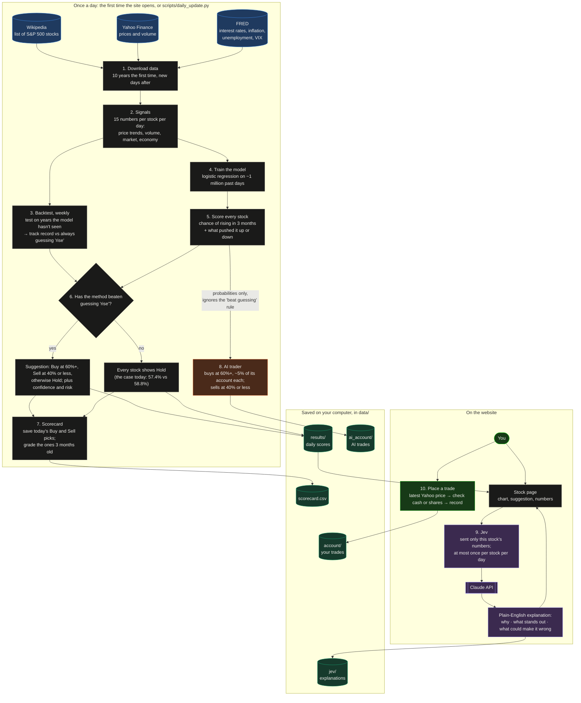

# How the site works

How data becomes a prediction, where Claude (through Jev) comes in, and what
happens when a trade is placed. GitHub shows the diagram as a picture.

Jev is the only part that uses Claude. It explains predictions; it never
makes or changes them. The predictions come from a statistics model that runs
on the user's computer.

## Key

| Color | Meaning |
| --- | --- |
| Blue | Free outside data sources |
| Gray | Steps that run on the user's computer |
| Orange | The AI trader, which trades by itself in its own account |
| Purple | Jev, the only part that uses Claude |
| Green | You, and what you do |
| Teal | Files saved in `data/` |
